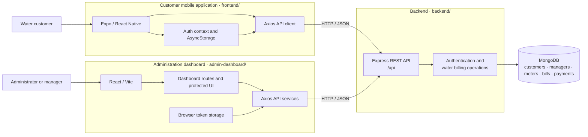

# Shaba Billing System

Shaba Billing System is a water-utility management platform for administering customers, meter readings, bills, and payments. This monorepo brings together the customer mobile app, the Express API, and the web administration dashboard while preserving each project's Git history.

## Repository layout

| Directory | Project | Description |
| --- | --- | --- |
| [`frontend/`](./frontend/) | Customer mobile app | Expo and React Native app for customer sign-in, bills, payments, payment history, and profile features. |
| [`backend/`](./backend/) | API server | Node.js and Express API backed by MongoDB. |
| [`admin-dashboard/`](./admin-dashboard/) | Web administration | React and Vite dashboard for managing customers, meters, billing, reports, and manager accounts. |

Each project has its own `package.json` and dependencies. Install dependencies and run scripts from that project's directory.

## Architecture



### Request and data flow

1. A customer signs in through the mobile app, or an administrator or manager signs in through the dashboard.
2. The app receives an authentication token from the API. The mobile app stores it with AsyncStorage; the browser dashboard stores it in `localStorage`. API clients attach the token to requests where supported.
3. The client calls the Express API under `/api` to read or update account, customer, meter, bill, or payment data.
4. The API processes the request and reads or writes records in MongoDB, then returns JSON to the client.

The running API is started from `backend/src/server.js` and exposes routes for authentication, managers, customers, meters, bills and billing, payments, dashboard statistics, and transactions. `backend/src/app.js` also contains a modular Express app configuration.

## Technology

- **Mobile:** React Native, Expo, React Navigation, AsyncStorage, and Axios
- **Web:** React, Vite, React Router, and Axios
- **API:** Node.js and Express
- **Database:** MongoDB with Mongoose
- **Deployment configuration:** Render for the API and Vercel rewrites for the dashboard

## Local development

### Prerequisites

- Node.js 20.19 or newer
- npm
- MongoDB, local or hosted
- Expo Go or an Android/iOS development environment for mobile testing

### 1. Configure the API

Create `backend/.env` (do not commit it):

```dotenv
MONGO_URI=mongodb://127.0.0.1:27017/shaba_water_system
PORT=5000
ADMIN_USERNAME=your-admin-username
ADMIN_PASSWORD=use-a-unique-password
```

`MONGO_URI` is used by the API and admin-creation script. `PORT` is optional and defaults to `5000`. `ADMIN_USERNAME` and `ADMIN_PASSWORD` are needed when creating the initial administrator account.

Install dependencies and start the API:

```bash
cd backend
npm install
npm start
```

For development with automatic restarts, run `npm run dev` instead. To create the initial administrator account, run `npm run create-admin` after setting the admin credentials in `backend/.env`.

### 2. Run the web dashboard

In a second terminal:

```bash
cd admin-dashboard
npm install
npm run dev
```

Vite serves the dashboard at `http://localhost:5173`. The dashboard API client defaults to the deployed API, so set `VITE_API_BASE` in `admin-dashboard/.env.local` to use your local API through the Vite development proxy:

```dotenv
VITE_API_BASE=/api
```

The Vite proxy forwards `/api` requests to `http://localhost:5000`. Alternatively, set `VITE_API_BASE` to an absolute API URL, such as `http://localhost:5000/api` or `https://your-api-host.example.com/api`.

Build and lint the dashboard with `npm run build` and `npm run lint`, respectively.

### 3. Run the customer mobile app

In another terminal:

```bash
cd frontend
npm install
npm start
```

The mobile API base URL is currently set in `frontend/src/services/api.js`. Configure it for the device running the app before testing:

- Android emulator: use `http://10.0.2.2:5000/api`.
- iOS simulator: use `http://localhost:5000/api`.
- Physical device: use the computer's LAN IP address, with the phone and computer on the same network.

The API must be reachable from the device. A device cannot normally reach a server using the computer's `localhost` address.

## Deployment

- **API:** `backend/render.yaml` configures a Render web service with `backend/` as its root directory. Configure `MONGO_URI`, `ADMIN_USERNAME`, and `ADMIN_PASSWORD` as protected deployment environment variables.
- **Dashboard:** Set the deployment root directory to `admin-dashboard/`. `admin-dashboard/vercel.json` forwards `/api` requests to the configured backend host. Set `VITE_API_BASE` when building if the API should differ from the current configured default.
- **Mobile app:** Use Expo's platform-specific workflows (`npm run android`, `npm run ios`, or `npm run web`) and configure the API base URL for each target environment.

## Security

- Never commit `.env` files, API keys, passwords, database connection strings, or other credentials. Use local environment files or your deployment provider's secret settings.
- If a credential has ever been committed or otherwise exposed, rotate or revoke it. Removing a secret from a later commit does not invalidate it.
- Review authentication, API authorization, CORS, and payment handling before exposing a deployment to production traffic.

## Repository history

The original project histories are included in this repository under their respective directories. Because the commits were rewritten to place each project's files in a subdirectory, commit hashes differ from those in the source repositories; commit messages, authors, and dates are retained.
